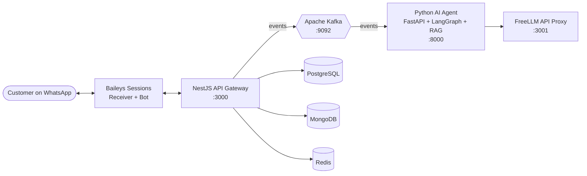

<div align="center">

# 🍽️ PEARSON

### Autonomous AI Voice Ordering System for Restaurants

*Making restaurant ordering autonomous through AI and WhatsApp.*


</div>

---

## 🧭 Navigate

| Command | Jump to |
| :-- | :-- |
| `$ pearson --about` | [About](#about) |
| `$ cat features.txt` | [Features](#features) |
| `$ pearson --stack` | [Technology Stack](#stack) |
| `$ pearson --architecture` | [Architecture](#architecture) |
| `$ which node pnpm uv docker` | [Prerequisites](#prerequisites) |
| `$ git clone` | [Getting Started](#getting-started) |
| `$ ./scripts/setup-and-run.sh` | [Automated Setup](#setup) |
| `$ cat .env` | [Environment Config](#env) |
| `$ docker compose ps` | [Infrastructure](#infra) |
| `$ curl /whatsapp/qr` | [WhatsApp Integration](#whatsapp) |
| `$ tree .` | [Project Structure](#structure) |
| `$ pnpm dev:api` | [Manual Development](#manual) |
| `$ tail -f *.log` | [Troubleshooting](#troubleshooting) |
| `$ Kill` | [Stopping](#stopping) |
| `$ git push` | [Contributing](#contributing) |

---

<a id="about"></a>
## $ pearson --about

**PEARSON** is an open-source, headless AI-powered ordering platform designed for restaurants. It lets restaurant owners manage orders through **WhatsApp** while an autonomous AI engine handles voice conversations and menu-driven ordering.

Built with a modern **TypeScript** and **Python** architecture, PEARSON integrates WhatsApp connectivity, AI agents, event-driven communication, and scalable infrastructure — **no traditional web dashboard required**.

---

<a id="features"></a>
## $ cat features.txt

- 🤖 **AI-Powered Ordering** — Automates customer conversations and menu-driven ordering.
- 💬 **WhatsApp Integration** — Connects restaurant WhatsApp accounts using Baileys.
- 🧠 **Autonomous AI Agent** — Python, FastAPI, LangGraph, and RAG for agent workflows.
- 📡 **Event-Driven Architecture** — Apache Kafka coordinates backend and AI agent events.
- 🧩 **Headless Platform** — Manage restaurant operations without a traditional dashboard.
- ⚙️ **Automated Setup** — Checks and installs supported prerequisites and configures services.
- 🗄️ **Database Integration** — PostgreSQL, Drizzle ORM, and migrations.
- 🐳 **Infrastructure Management** — Supporting services run via Docker Compose.

---

<a id="stack"></a>
## $ pearson --stack

| Component | Technology |
| :-- | :-- |
| API Gateway | NestJS |
| AI Agent | Python, FastAPI |
| Agent Orchestration | LangGraph |
| Retrieval-Augmented Generation | RAG |
| WhatsApp Integration | Baileys |
| Event Streaming | Apache Kafka |
| Relational Database | PostgreSQL |
| Document Database | MongoDB |
| Cache | Redis |
| Database ORM | Drizzle ORM |
| JavaScript Runtime | Node.js |
| Package Manager | pnpm |
| Python Environment | uv |
| Infrastructure | Docker and Docker Compose |
| AI API Proxy | FreeLLM API |

---

<a id="architecture"></a>
## $ pearson --architecture



---

<a id="prerequisites"></a>
## $ which node pnpm python uv openssl docker git

PEARSON ships with an automated setup script that checks system requirements and installs missing prerequisites where supported.

| Requirement | Version / Purpose | Auto-installed? |
| :-- | :-- | :--: |
| Node.js | Version 24 or newer | ✅ via `fnm` |
| pnpm | Version 11 | ✅ |
| Python | Version 3.11 or newer | ❌ |
| uv | Python package and environment management | ✅ |
| OpenSSL | Encryption key generation | ⚠️ checked |
| Docker | Container runtime | ⚠️ checked |
| Docker Compose | Infrastructure orchestration | ⚠️ checked |
| Git | Repository cloning and version control | ❌ |

> **Note:** Installation behavior depends on your operating system and the package managers available on your machine. Docker and OpenSSL must be available; the script checks them and may attempt supported installation steps.

<details>
<summary>📝 <b>Pre-flight checklist (click to expand)</b></summary>

<br/>

- [ ] Node.js ≥ 24
- [ ] pnpm 11
- [ ] Python ≥ 3.11
- [ ] uv installed
- [ ] OpenSSL available
- [ ] Docker daemon running
- [ ] Docker Compose available
- [ ] Ports `3000`, `3001`, `5432`, `6379`, `8000`, `9092`, `27017` free

</details>

---

<a id="getting-started"></a>
## $ git clone

```bash
git clone <YOUR_REPOSITORY_URL>
cd Pearson
```

> Replace `<YOUR_REPOSITORY_URL>` with the actual Git repository URL.

---

<a id="setup"></a>
## $ ./scripts/start.sh

```bash
chmod +x scripts/start.sh
./scripts/start.sh
```

The script interactively prepares the development environment, configures required services, runs database migrations, builds the applications, and launches the backend services.

### What happens during setup

1. Checks required system prerequisites.
2. Clones the FreeLLM API proxy repository if it is not already present.
3. Generates a 32-byte hexadecimal encryption key for the proxy configuration.
4. Starts the FreeLLM API container and displays its activation code.
5. Prompts for the FreeLLM API key.
6. Creates the root `.env` configuration file.
7. Starts the infrastructure containers.
8. Installs JavaScript and Python dependencies.
9. Builds the database package and runs migrations.
10. Builds the API and web workspaces.
11. Launches the API gateway and Python AI agent.
12. Streams API logs and monitors WhatsApp QR-code output.

### Setup stages (expand each)

<details>
<summary><b>Stage 1 — System Prerequisites</b></summary>

<br/>

- Validates OpenSSL availability.
- Checks Docker and Docker Compose.
- Checks and installs Node.js 24+ through `fnm`, if required.
- Checks and installs pnpm 11.
- Checks and installs the `uv` Python package manager.

</details>

<details>
<summary><b>Stage 2 — FreeLLM API Proxy</b></summary>

<br/>

- Clones the FreeLLM API repository into `scripts/freellmapi`.
- Generates an encryption key and writes it to the proxy's `.env` file.
- Starts the proxy using Docker Compose.
- Displays the activation code in the terminal.

</details>

<details>
<summary><b>Stage 3 — Environment Configuration</b></summary>

<br/>

The script prompts for the required FreeLLM API key and creates the root `.env` file, including:

- Application port
- PostgreSQL credentials and database URL
- MongoDB connection URL
- Redis connection URL
- Kafka connection URL
- Google API key
- Python agent service URL

</details>

<details>
<summary><b>Stage 4 — Infrastructure Startup</b></summary>

<br/>

- Checks for PostgreSQL port conflicts.
- Starts the infrastructure using Docker Compose (managed from `infra/`).
- Verifies container health.

</details>

<details>
<summary><b>Stage 5 — Dependencies, Migrations, and Builds</b></summary>

<br/>

- Installs root workspace dependencies with pnpm.
- Synchronizes the Python environment using `uv sync`.
- Builds the `@Pearson/database` package.
- Runs database migrations and generates the database client.
- Installs and builds the API application.
- Installs and builds the web application.

</details>

<details>
<summary><b>Stage 6 — Background Services and Logging</b></summary>

<br/>

| Service | Launch Command | Log File |
| :-- | :-- | :-- |
| NestJS API | `pnpm run start:dev` | `apps/api/api.log` |
| Python Agent | `uv run fastapi dev src/main.py` | `services/agent/agent.log` |

API logs are streamed to the terminal. The script also monitors log output for WhatsApp QR codes and supports clean shutdown of the managed processes.

</details>

---

<a id="env"></a>
## $ cat .env

```dotenv
PORT=3000

# PostgreSQL
POSTGRES_USER=your_postgres_user
POSTGRES_PASSWORD=your_postgres_password
POSTGRES_DB=your_database
DATABASE_URL=your_postgres_connection_url

# Supporting Services
MONGO_URL=your_mongodb_connection_url
REDIS_URL=your_redis_connection_url
KAFKA_URL=your_kafka_connection_url

# AI Configuration
GOOGLE_API_KEY=your_google_api_key

# Agent Service
AGENT_URL=http://localhost:8000
```

> ⚠️ **Important:** This is an illustrative template. Use the exact variable names and values generated or expected by your project's configuration files. **Never commit API keys, passwords, or other secrets to version control.**

---

<a id="infra"></a>
## $ docker compose -f infra/docker-compose.yml ps

| Service | Local Address | Type |
| :-- | :-- | :-- |
| PostgreSQL | `localhost:5432` | Infrastructure |
| Apache Kafka | `localhost:9092` | Infrastructure |
| MongoDB | `localhost:27017` | Infrastructure |
| Redis | `localhost:6379` | Infrastructure |
| FreeLLM API Proxy | `http://localhost:3001` | Infrastructure |
| NestJS API Gateway | `http://localhost:3000` | Application |
| Python AI Agent | `http://localhost:8000` | Application |

The API gateway and AI agent are application services rather than infrastructure containers in the core `infra/` stack.

> These are the expected local endpoints. Actual availability depends on successful startup and the project's configuration.

---

<a id="whatsapp"></a>
## $ curl localhost:3000/whatsapp/qr

PEARSON initializes **two separate WhatsApp sessions** using Baileys.

| Session | Role |
| :-- | :-- |
| **Receiver** | Starts first when the backend gateway launches. Establishes the initial WhatsApp connection. |
| **Bot** | Initializes after the receiver session successfully connects. |

When authentication is required, the API emits a QR code. During automated execution, QR output is monitored from `apps/api/api.log` and displayed in the terminal when detected. You can also fetch the QR values through the API:

<details open>
<summary><b>🔗 Get the Receiver QR code</b></summary>

```bash
curl "http://localhost:3000/whatsapp/qr?role=receiver"
```

</details>

<details open>
<summary><b>🤖 Get the Bot QR code</b></summary>

```bash
curl "http://localhost:3000/whatsapp/qr?role=bot"
```

</details>

<details open>
<summary><b>📶 Check connection status</b></summary>

```bash
curl "http://localhost:3000/whatsapp/status"
```

</details>

Scan the returned QR codes using the appropriate WhatsApp account or linked-device workflow.

✅ Once both sessions are connected, the API emits the **`ai-login-procedure`** readiness event to Apache Kafka, indicating the system is ready to go live.

---

<a id="structure"></a>
## $ tree .

```text
Pearson/
├── apps/
│   ├── api/                         # NestJS API gateway, Baileys WhatsApp, Kafka producer
│   └── web/                         # Web workspace
│
├── packages/
│   ├── database/                    # Drizzle ORM schema, migrations, and client
│   ├── eslint-config/               # Shared ESLint configuration
│   └── typescript-config/           # Shared TypeScript configuration
│
├── services/
│   └── agent/                       # Python AI agent: FastAPI, LangGraph, RAG, Kafka consumer
│
├── scripts/
│   ├── setup-and-run.sh             # Automated setup and execution script
│   └── freellmapi/                  # FreeLLM API proxy repository
│
├── infra/
│   ├── docker-compose.yml           # Infrastructure services
│   └── docker/                      # Infrastructure Dockerfiles
│
├── .env                             # Generated root environment configuration
├── package.json                     # Workspace dependencies and scripts
└── pnpm-workspace.yaml              # pnpm workspace configuration
```

---

<a id="manual"></a>
## $ pnpm dev:api

Prefer to start components individually instead of using the automated script?

<details>
<summary><b>▶️ Start the NestJS API</b></summary>

```bash
pnpm dev:api
```

</details>

<details>
<summary><b>🐍 Start the Python AI Agent</b></summary>

```bash
cd services/agent
uv run fastapi dev src/main.py
```

</details>

<details>
<summary><b>🗄️ Run database migrations</b></summary>

```bash
cd packages/database
pnpm run db:migrate
pnpm run db:generate
```

</details>

<details>
<summary><b>🏗️ Build, type-check, and lint</b></summary>

Run from the repository root:

```bash
pnpm build
pnpm check-types
pnpm lint
```

</details>

---

<a id="troubleshooting"></a>
## $ tail -f apps/api/api.log

```bash
# API logs
tail -f apps/api/api.log

# Python agent logs
tail -f services/agent/agent.log

# Infrastructure container status
docker compose -f infra/docker-compose.yml ps

# Infrastructure logs
docker compose -f infra/docker-compose.yml logs -f
```

### Common issues (click to expand)

<details>
<summary>🐳 <b>Docker containers fail to start</b></summary>

<br/>

- Ensure Docker is installed and running.
- Check container health and inspect the infrastructure logs.
- Verify that the required ports are available.

</details>

<details>
<summary>🐘 <b>PostgreSQL port conflict</b></summary>

<br/>

- Check whether another PostgreSQL instance is already using port `5432`.
- Stop the conflicting service or update the port configuration consistently.

</details>

<details>
<summary>📱 <b>WhatsApp QR code is not appearing</b></summary>

<br/>

- Inspect `apps/api/api.log`.
- Verify that the API gateway is running.
- Check the WhatsApp QR and status endpoints.

</details>

<details>
<summary>🤖 <b>AI agent fails to start</b></summary>

<br/>

- Verify that Python 3.11 or newer is available.
- Run `uv sync` from `services/agent`.
- Inspect `services/agent/agent.log`.
- Verify that the required environment variables are configured.

</details>

<details>
<summary>🧱 <b>Database migration errors</b></summary>

<br/>

- Confirm that PostgreSQL is running and reachable.
- Verify `DATABASE_URL`.
- Review the migration output before rerunning the migration commands.

</details>

<details>
<summary>🔑 <b>FreeLLM API activation issues</b></summary>

<br/>

- Review the activation code displayed by the proxy container.
- Verify the API key and encryption configuration.
- Inspect the proxy container logs.

</details>

---

<a id="stopping"></a>
## $ Kill

When launched through the automated setup script, the API, Python agent, log streaming, and shutdown handlers are managed by the script. To stop the managed services cleanly, type the following at the script's interactive prompt:

```text
Kill
```

For services started manually, stop the foreground processes with `Ctrl+C`.

Stop the infrastructure containers separately:

```bash
docker compose -f infra/docker-compose.yml down
```

> This stops and removes the Compose containers and network. Persistent data behavior depends on the configured volumes.

---

## $ cat SECURITY.md

- 🔒 Keep `.env` files and credentials out of version control.
- 🔒 Never publish API keys, database passwords, or encryption keys.
- 🔒 Use a unique, securely generated encryption key for the FreeLLM API proxy.
- 🔒 Restrict access to local services when exposing the application beyond your development machine.
- 🔒 Configure production-grade authentication, network security, logging, and secret management before deployment.
- 🔒 Handle WhatsApp session credentials and authentication data securely.

---

<a id="contributing"></a>
## $ git push

Contributions, bug reports, and feature requests are welcome.

```bash
# 1. Fork the repository, then create a feature branch
git checkout -b feature/my-change

# 2. Make your changes, then run the checks
pnpm check-types
pnpm lint
pnpm build

# 3. Commit and push
git commit -am "Describe your change"
git push origin feature/my-change
```

Then open a pull request describing your changes. Please ensure that secrets, generated credentials, and local environment files are not included in commits.

---

## $ cat LICENSE

PEARSON is intended to be an open-source project.

---

<div align="center">

**PEARSON** — *Making restaurant ordering autonomous through AI and WhatsApp.*

</div>